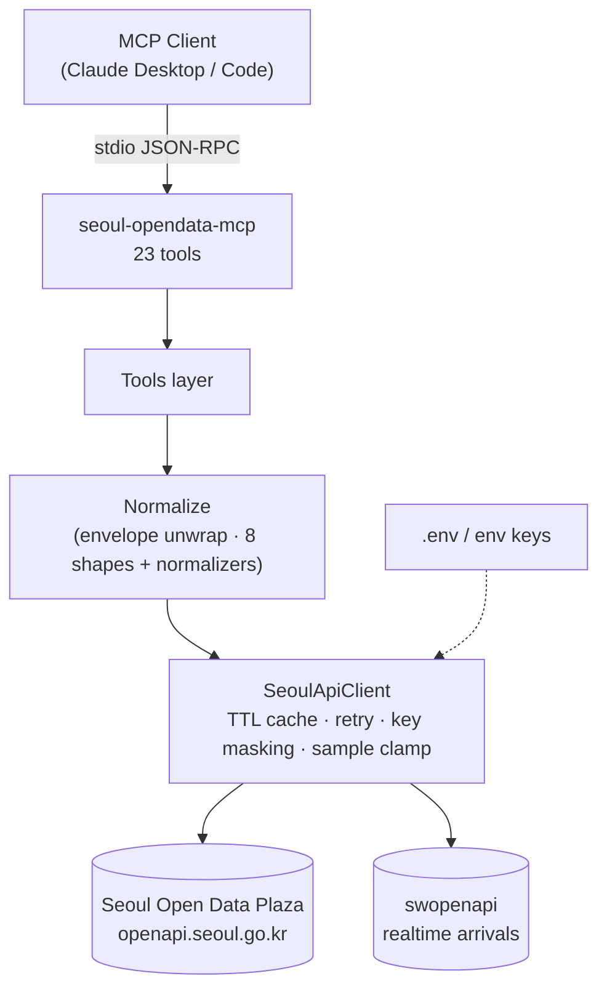

# Seoul OpenData MCP

[]()
[](./LICENSE)
[]()
[]()
<a href="#english"></a>
<a href="#korean"></a>

An MCP server that wraps Seoul's real-time city data (Seoul Open Data Plaza) into 23 tools any MCP client can call, with zero setup beyond an optional API key. | 서울 열린데이터광장의 실시간 도시데이터를 23개 tool로 감싸는 MCP 서버로, 인증키 없이도 바로 사용할 수 있습니다.

---

<a id="english"></a>

# English

## Overview

Seoul OpenData MCP is a stdio [MCP](https://modelcontextprotocol.io) server, written in TypeScript, that exposes Seoul's real-time city data (Seoul Open Data Plaza) as 23 tools grouped into 9 categories — population and commercial activity, transit, culture and public reservations, environment, batch statistics, real estate, health, and a dataset catalog. It also ships a searchable catalog covering 52 raw Seoul Open Data datasets, so an MCP client such as Claude can go from a dataset id straight to a live API call. The server needs no setup beyond an optional API key — it runs in a scope-limited sample mode out of the box.

## Features

- **Hotspot resolution & live snapshot** — `search_place` fuzzy-matches a free-form place name to one of 121 official real-time hotspots, and `get_city_snapshot` / `get_disaster_alerts` return a combined population + weather + traffic + events snapshot, or recent emergency alerts, for one.
- **12-hour AI population forecast & congestion** — `get_population` reports real-time population, a 4-level congestion label (여유/보통/약간 붐빔/붐빔), demographics, and an optional 12-hour AI-generated forecast.
- **Card-payment commercial activity** — `get_commercial_activity` surfaces real-time, card-payment-based commercial activity levels and per-industry breakdowns across 82 of the 121 hotspots.
- **Transit suite** — `get_subway_arrivals`, `get_subway_schedule`, `get_bike_stations`, `get_parking`, and `get_road_traffic` cover realtime subway arrivals, first/last trains and station timetables, Ttareungi bike-share availability, public parking space counts with fees and hours, and road speed/incidents.
- **Batch statistics** — `get_subway_ridership`, `get_subway_hourly_ridership`, `get_living_population`, and `find_pharmacies` cover daily and hourly ridership, de-facto living population, and pharmacy hours from batch (lagged) datasets.
- **Public service reservations** — `search_public_reservations` searches bookable Seoul public services (sports facilities, cultural and kids programs, rooms and camping, classes, clinics) with status, fee, and booking URL.
- **Real estate** — `get_real_estate_prices` returns sale and rent (jeonse / monthly rent) transactions filtered on the server by year, district, legal dong, building name, and building type, and `get_land_price` returns the officially assessed land price per square meter for a parcel.
- **Dataset catalog** — `search_dataset`, `get_dataset_spec`, and `call_dataset` search, inspect, and directly call any of the 52 curated Seoul Open Data datasets, including the 27 that have no dedicated tool.
- **Zero-config sample mode, dual API keys, caching** — runs with no keys at all, supports two independent API keys (general + subway) with fallback, and caches every upstream response in memory (TTL tuned per dataset) to protect the ~1,000-call/day free quota.

## Architecture



- Every upstream call goes through a single HTTP path in `SeoulApiClient` (recorded as [ADR-003](docs/decisions/ADR-003-single-http-path-and-env-keys.md)), so caching, retry, sample clamping, and error handling are implemented once for every tool.
- Every tool returns the same `{data, asOf, source, notes}` envelope, regardless of which of the 8 raw upstream shapes it started from.
- Per-service cache TTLs (5 min citydata/bike/parking/air, 6h cultural events, 15s subway arrivals) protect the ~1,000-call/day free quota.
- API keys are masked before they can ever appear in a log line or an error message.

## Prerequisites

- Node.js 18 or later
- An MCP client (Claude Desktop, Claude Code, or any MCP-compatible client)
- (Optional) Seoul Open Data API keys — the server runs in sample mode without them

## Installation

### Claude Desktop

Add this to your `claude_desktop_config.json` ([config file location](https://modelcontextprotocol.io/quickstart/user)):

```json
{
  "mcpServers": {
    "seoul-opendata": {
      "command": "npx",
      "args": ["-y", "seoul-opendata-mcp"],
      "env": { "SEOUL_API_KEY": "YOUR_KEY" }
    }
  }
}
```

Restart Claude Desktop and the 23 tools below become available.

### Claude Code

> The `.mcpb` bundle is for Claude Desktop (the chat app) only. For Claude Code (CLI and desktop app), install as below — register once in the terminal and the same server is available in the Claude Code desktop app as well.

#### Install from source

```bash
git clone https://github.com/whchoi98/seoul-opendata-mcp.git && cd seoul-opendata-mcp
npm install && npm run build

claude mcp add seoul-opendata \
  -e SEOUL_API_KEY=YOUR_KEY \
  -e SEOUL_SUBWAY_API_KEY=YOUR_SUBWAY_KEY \
  --scope user \
  -- node $(pwd)/dist/index.js
```

- `SEOUL_API_KEY` — issued free at data.seoul.go.kr. Leave empty for sample mode (single 광화문·덕수궁 hotspot only)
- `SEOUL_SUBWAY_API_KEY` — dedicated key for realtime subway arrivals (optional). Falls back to `SEOUL_API_KEY` when empty
- `--scope user` — available in every project. Omit it to register for the current project only (default: local)

#### Verify the installation

```bash
claude mcp list          # look for ✓ seoul-opendata
```

Run `/mcp` inside a Claude Code session (desktop app included) to confirm the 23 tools are loaded, then test with "지금 강남역 지하철 도착 알려줘".

#### Import from Claude Desktop (macOS/WSL)

If the server is already installed in Claude Desktop, import the configuration as-is:

```bash
claude mcp add-from-claude-desktop
```

### Codex CLI

```bash
codex mcp add seoul-opendata --env SEOUL_API_KEY=YOUR_KEY -- npx -y seoul-opendata-mcp
```

Or add it directly to `~/.codex/config.toml`:

```toml
[mcp_servers.seoul-opendata]
command = "npx"
args = ["-y", "seoul-opendata-mcp"]
env = { SEOUL_API_KEY = "YOUR_KEY" }
```

### Kiro CLI

```bash
kiro-cli mcp add --name seoul-opendata --command npx --args "-y,seoul-opendata-mcp" \
  --env SEOUL_API_KEY=YOUR_KEY --scope global
```

The server is saved to `~/.kiro/settings/mcp.json` (use `--scope workspace` for a per-project setup). Verify with `kiro-cli mcp list`.

### One-click (MCPB)

Download the `.mcpb` bundle from the [latest release](https://github.com/whchoi98/seoul-opendata-mcp/releases/latest) and double-click it — Claude Desktop installs the server with no terminal required.

## Deploy to AgentCore Runtime

Besides the stdio server above, this repo also ships a Streamable HTTP entrypoint (`src/http.ts` → `dist/http.js`) that satisfies the [Amazon Bedrock AgentCore Runtime](https://docs.aws.amazon.com/bedrock-agentcore/latest/devguide/runtime.html) contract: a container listening on `0.0.0.0:8000`, `POST /mcp` for JSON-RPC, and `GET /ping` for health checks.

> **Warning: this creates real, billable AWS resources** (an ECR repository, AgentCore Runtime session compute, and — if you opt into `CACHE_TABLE_NAME` below — a DynamoDB table). Only run these steps if you intend to provision and pay for them; nothing here runs automatically.

1. **Build the container and push it to ECR** — the `Dockerfile` is a multi-stage, `linux/arm64` build (AgentCore Runtime requires ARM64) that ends in `CMD ["node", "dist/http.js"]`:

   ```bash
   docker build --platform linux/arm64 -t seoul-opendata-mcp .
   aws ecr create-repository --repository-name seoul-opendata-mcp
   docker tag seoul-opendata-mcp:latest <account-id>.dkr.ecr.<region>.amazonaws.com/seoul-opendata-mcp:latest
   aws ecr get-login-password --region <region> | docker login --username AWS --password-stdin <account-id>.dkr.ecr.<region>.amazonaws.com
   docker push <account-id>.dkr.ecr.<region>.amazonaws.com/seoul-opendata-mcp:latest
   ```

   Then create (or update) the AgentCore Runtime from that image — see [`docs/runbooks/agentcore-deploy.md`](docs/runbooks/agentcore-deploy.md) for the full copy-paste `create-agent-runtime`/rollback/incident sequence.

2. **(Optional) Create the shared DynamoDB cache/quota table** — setting `CACHE_TABLE_NAME` turns on a second cache tier (L2) shared by every concurrent AgentCore Runtime session, plus a durable daily quota ledger; without it, each session only has its own in-memory (L1) cache and its own quota count. Pre-create the table before setting the env var:

   ```bash
   aws dynamodb create-table --table-name seoul-mcp-cache \
     --attribute-definitions AttributeName=pk,AttributeType=S \
     --key-schema AttributeName=pk,KeyType=HASH \
     --billing-mode PAY_PER_REQUEST
   aws dynamodb update-time-to-live --table-name seoul-mcp-cache \
     --time-to-live-specification "Enabled=true,AttributeName=expireAt"
   ```

3. **Environment variables**

   | Variable | Description | Default |
   |---|---|---|
   | `SEOUL_API_KEY` | General API key (same as stdio mode). | `sample` |
   | `SEOUL_SUBWAY_API_KEY` | Subway-only key (same as stdio mode). | falls back to `SEOUL_API_KEY` |
   | `CACHE_TABLE_NAME` | Optional — DynamoDB table name for the shared global L2 cache and daily quota ledger. Unset means L1-only, per-session cache and quota. | (unset) |
   | `QUOTA_DAILY_LIMIT` | Daily per-key call budget before the server switches to stale-only responses. | `1000` |
   | `PORT` | HTTP listen port. | `8000` |

4. **Extending via AgentCore Gateway** — to expose these 23 tools to other agents/orchestrators without touching any code, register the deployed Runtime endpoint as an `mcpServer`-type target on an [AgentCore Gateway](https://docs.aws.amazon.com/bedrock-agentcore/latest/devguide/gateway.html). The Streamable HTTP contract this server already implements is exactly what a Gateway target expects, so this is a registration-only step — no changes to this repository.

## Getting API Keys (5 minutes)

The server works out of the box in **sample mode** (see limits below), but real keys remove the limits and are free:

1. Sign in (or sign up) at [data.seoul.go.kr](https://data.seoul.go.kr).
2. Open the authentication-key request page ("인증키 신청") and submit the short application form.
3. The key is issued immediately — no waiting for approval.
4. Put it in `SEOUL_API_KEY` (as shown above) and restart your MCP client.

Without `SEOUL_API_KEY`, the server falls back to a built-in `sample` key: the `citydata`-family tools (`get_city_snapshot`, `get_population`, `get_commercial_activity`, `get_road_traffic`, `get_weather`, `get_disaster_alerts`) only work for the single **광화문·덕수궁 (Gwanghwamun·Deoksugung)** hotspot, and the other tools return at most **5 rows**. Every sample-mode response includes a note reminding you of this.

There are two keys in total:

- **`SEOUL_API_KEY`** — the general key, used by every tool except realtime subway arrivals.
- **`SEOUL_SUBWAY_API_KEY`** — a separate key for `get_subway_arrivals` (realtime subway arrivals), requested independently on data.seoul.go.kr. Optional — if unset, the server falls back to `SEOUL_API_KEY`.

### Local development with `.env`

Copy `.env.example` to `.env` and fill in your key(s):

```bash
cp .env.example .env
# then edit .env: SEOUL_API_KEY=... (and optionally SEOUL_SUBWAY_API_KEY=...)
```

`.env` is listed in `.gitignore` and is never committed — only the empty `.env.example` template is tracked in the repo.

## Usage

- `"지금 강남역 혼잡도 어때?"` — congestion level right now
- `"홍대 앞으로 12시간 동안 인구가 어떻게 변할까?"` — 12-hour population forecast
- `"성수동 상권 요즘 분위기 어때?"` — commercial activity trend
- `"여의도 근처에 따릉이 자전거 있어?"` — nearby Ttareungi bike availability
- `"이번 주말 마포구 무료 공연 있어?"` — free cultural events this weekend
- `"오늘 강남구 미세먼지 어때?"` — today's fine dust level
- `"어제 강남역 승하차 몇 명이야?"` — yesterday's boarding/alighting count at Gangnam station
- `"서울 공공와이파이 데이터 찾아줘"` — find Seoul's public WiFi dataset

## Configuration

| Variable | Description | Default |
|----------|-------------|---------|
| `SEOUL_API_KEY` | General API key, used by every tool except realtime subway arrivals. Falls back to a built-in, scope-limited sample key when unset. | `sample` |
| `SEOUL_SUBWAY_API_KEY` | Optional, dedicated key for `get_subway_arrivals` (realtime subway arrivals). Falls back to `SEOUL_API_KEY` when unset. | (falls back to `SEOUL_API_KEY`) |

`.env` is read by a dependency-free loader that only fills variables not already set on `process.env`. Precedence is: explicit environment variables > `.env` file > built-in sample key.

## Tools

23 tools grouped into 9 categories:

| Tool | Description | Key arguments |
|---|---|---|
| **Common** | | |
| `search_place` | Resolve a free-form place name to one of Seoul's 121 official real-time hotspots. Use this first when the user mentions a Seoul location. | `query` (string) |
| `get_city_snapshot` | One-shot combined snapshot (population/congestion + weather + road traffic + top events) of a hotspot. Best for broad "how is X right now?" questions. | `place` (string) |
| `get_disaster_alerts` | Recent emergency disaster text alerts (긴급재난문자) issued for a hotspot area. | `place` (string) |
| **Population & Commerce** | | |
| `get_population` | Real-time population, congestion level (여유/보통/약간 붐빔/붐빔), demographics, and optional 12-hour AI forecast. | `place` (string), `includeForecast` (boolean, optional) |
| `get_commercial_activity` | Real-time card-payment-based commercial activity level and per-industry breakdown (82 supported places). | `place` (string) |
| **Transit** | | |
| `get_subway_arrivals` | Real-time subway train arrivals for a station. | `station` (string), `limit` (1-30, default 10) |
| `get_subway_schedule` | First and last train times (both directions) for a station on lines 1-9, with an optional timetable of upcoming departures. | `station` (string), `line`, `day` (`weekday`/`saturday`/`holiday`), `includeTimetable`, `after` (HH:MM), `limit` (1-30, default 5) |
| `get_bike_stations` | Find Ttareungi (서울 공공자전거) stations by name keyword and/or coordinates, with real-time available bike counts. | `query` (string, optional), `lat`/`lng` (optional), `radiusM` (default 500), `limit` (1-50, default 10) |
| `get_parking` | Real-time available spaces in Seoul public parking lots, filtered by a place/district keyword, plus fees and hours of public lots without realtime data (`otherLots`). | `query` (string), `limit` (1-50, default 10), `includeNonRealtime` (default true) |
| `get_road_traffic` | Average road speed, congestion message, and accident/control incidents around a hotspot. | `place` (string) |
| **Culture** | | |
| `search_cultural_events` | Search Seoul cultural events (concerts, exhibitions, festivals) by keyword/category/district/date range/free-only. | `keyword`, `category`, `district`, `from`, `to`, `freeOnly`, `limit` (all optional) |
| `search_public_reservations` | Search bookable public services on yeyak.seoul.go.kr (sports facilities, cultural and kids programs, rooms and camping, classes, clinics) with status, fee, and booking URL. | `category` (`culture`/`sports`/`facility`/`education`/`medical`), `subcategory`, `district`, `keyword`, `target`, `freeOnly`, `openOnly`, `limit` (1-50, default 10) |
| **Environment** | | |
| `get_air_quality` | Real-time air quality (PM10/PM2.5, grade) by district. Omit district for all 25. | `district` (string, optional) |
| `get_weather` | Current temperature, precipitation, fine dust (PM10/PM2.5), UV, sunrise/sunset and weather warnings at a hotspot. | `place` (string) |
| **Statistics (batch)** | | |
| `get_subway_ridership` | Per-station daily subway boarding/alighting counts for a date (data available up to ~2-4 days ago). | `date` (YYYYMMDD), `station`/`line` (optional filters), `limit` (1-100, default 20) |
| `get_subway_hourly_ridership` | Monthly boarding/alighting counts by hour (04-03h) for a station, with the busiest and quietest hours. | `station` (string), `line` (optional), `month` (YYYYMM, defaults to the latest published) |
| `get_living_population` | De-facto (living) population estimates by administrative dong and hour (batch, ~5-day lag). | `date` (YYYYMMDD, optional), `timeSlot` (00-23, optional), `dongCode` (optional), `limit` (1-100, default 20) |
| **Real Estate** | | |
| `get_real_estate_prices` | Seoul real-estate sale or rent transactions (amounts in 만원/10k KRW), newest contract first, filtered on the server by year, district, legal dong, building name, and building type. Cancelled sales are excluded by default. | `dealType` (`sale` default / `rent`), `district`, `dong`, `building`, `buildingUse`, `year` (YYYY), `rentType` (전세/월세), `includeCancelled`, `limit` (1-50, default 10) — all optional |
| `get_land_price` | Officially assessed individual land price (KRW per m²) for parcels in a district, narrowed by legal dong and lot number. | `district` (string), `dong`, `lotNumber` (e.g. `633-7`), `year` (YYYY, defaults to the latest published), `limit` (1-50, default 10) |
| **Health** | | |
| `find_pharmacies` | Find Seoul pharmacies by district or name keyword, with per-day operating hours. | `district`, `name`, `limit` (1-50, default 10) — all optional |
| **Catalog** | | |
| `search_dataset` | Search the curated catalog of 52 Seoul Open Data datasets by keyword (e.g. public WiFi, cold-wave shelters, public toilets). | `query` (string) |
| `get_dataset_spec` | Get the path parameters, response fields, and a call example for a catalog dataset id. | `id` (string) |
| `call_dataset` | Call a catalog dataset by id and get raw (non-normalized) rows — for datasets without a dedicated tool. | `id` (string), `params` (string[], optional), `limit` (optional, default 10, max 50) |

## Coverage & Limits

- **121 official hotspots, 5 official categories** — `search_place`, `get_city_snapshot`, `get_population`, `get_road_traffic`, and `get_weather` only cover these named locations: palaces & cultural heritage (고궁·문화유산), tourist zones (관광특구), parks (공원), commercial districts (발달상권), and dense hotspots (인구밀집지역).
- **Commercial activity: 82 of the 121 hotspots** — `get_commercial_activity` returns `supported: false` with nearby alternatives for the other 39.
- **Population has ~15 minutes of delay** — it's a telecom-based estimate with correction, not instantaneous.
- **Free quota is ~1,000 calls/day per key** — the server caches responses in memory (5 min for city data/air/bike/parking, 6 hours for cultural events) to help stay within this.
- **Even after the daily quota is exhausted, the server keeps serving from cache for up to 24 hours** and flags this with a note on the response; only past that 24-hour window does it fall back to an empty result with an explanatory note instead of an error.
- **Subway timetables cover lines 1-9 only** — `get_subway_schedule` skips other lines at the station (e.g. 경의선, 공항철도) and says so in `notes`. Holidays are not detected; pass `day: "holiday"`.
- **Public reservations list only services registered on yeyak.seoul.go.kr** — services not registered there do not appear (for example, no 송파구 tennis court was listed as of 2026-11).
- Bike stations, parking lots, air quality, cultural events, subway arrivals and timetables, public reservations, pharmacies, and the batch statistics tools are **not** limited to the 121 hotspots — they cover their respective full Seoul-wide datasets (e.g. all 25 districts for air quality, ~3,000 bike stations).
- **Real-estate filters** — year, district, legal dong (when given with `district`), building name, and building type are applied by the upstream API. `rentType`, and a `dong` given without `district`, are applied only within the latest 500 rows. `get_land_price` returns parcels in API order, not sorted by price.
- **Catalog tools cover 52 curated datasets** — `search_dataset` / `get_dataset_spec` / `call_dataset` give raw access to datasets that don't (yet) have a dedicated normalized tool.

## Project Structure

```text
seoul-opendata-mcp/
  src/
    client/          # HTTP client: SeoulApiClient (cache, retry, env loading)
    normalize/       # Envelope unwrap (8 shapes) + per-domain normalizers
    tools/           # 23 MCP tools grouped into 9 categories
    data/            # 121 hotspots + 52-dataset catalog
  tests/             # 170+ unit tests + 9 live tests; fixtures are real captures
  scripts/           # capture-fixtures, live-sweep, setup
  docs/              # architecture, api-reference, ADRs
```

## Testing

```bash
# Unit tests (133 tests, fixtures are real captured API responses)
npm test

# Live tests against the real Seoul Open Data API (9 tests, needs a real key)
RUN_LIVE=1 npx vitest run live

# Exercise all 23 tools end-to-end against the real API
npx tsx scripts/live-sweep.ts
```

## Data Attribution

Data is provided by the **Seoul Open Data Plaza** (서울 열린데이터광장, [data.seoul.go.kr](https://data.seoul.go.kr)) "Seoul Real-time City Data" (서울 실시간 도시데이터) service, which fuses telecom population data (KT/SKT), card-payment data (Shinhan Card), and transit tap-in/tap-out data (Tmoney), along with the Seoul public bike, parking, air-quality, cultural-event, and subway-arrival open APIs.

## Contributing

1. Fork the repository
2. Create your branch (`git checkout -b feat/amazing-feature`)
3. Commit changes (`git commit -m 'feat: add amazing feature'`)
4. Push to the branch (`git push origin feat/amazing-feature`)
5. Open a Pull Request

Commit messages follow [Conventional Commits](https://www.conventionalcommits.org/) (`feat:`, `fix:`, `docs:`, `test:`, `chore:`, ...).

## License

[MIT](./LICENSE) © 2026 whchoi98

## Contact

- Maintainer: [whchoi98](https://github.com/whchoi98)
- Issues: https://github.com/whchoi98/seoul-opendata-mcp/issues
- Email: whchoi98@gmail.com

---

<a id="korean"></a>

# 한국어

## 개요

Seoul OpenData MCP는 TypeScript로 작성된 stdio [MCP](https://modelcontextprotocol.io) 서버로, 서울 열린데이터광장의 실시간 도시데이터를 9개 카테고리, 23개 tool로 노출합니다 — 인구·상권, 교통, 문화와 공공예약, 환경, 배치 통계, 부동산, 보건, 데이터셋 카탈로그. 또한 서울 열린데이터광장 원본 데이터셋 52종을 검색할 수 있는 카탈로그를 함께 제공해, Claude 같은 MCP 클라이언트가 데이터셋 id만으로 바로 실시간 API를 호출할 수 있습니다. 인증키 없이도 범위가 제한된 샘플 모드로 바로 동작하므로 별도 설정이 필요 없습니다.

## 주요 기능

- **핫스팟 매칭 & 실시간 스냅샷** — `search_place`가 자연어 장소명을 서울 실시간 도시데이터 핫스팟 121곳 중 하나로 매칭하고, `get_city_snapshot` / `get_disaster_alerts`가 핫스팟의 인구+날씨+도로교통+주요 행사를 한 번에 조회하거나 최근 긴급재난문자를 반환합니다.
- **12시간 AI 인구 예측 & 혼잡도** — `get_population`이 실시간 인구, 4단계 혼잡도(여유/보통/약간 붐빔/붐빔), 성연령 비율, 선택적 12시간 AI 예측을 제공합니다.
- **카드 결제 기반 상권 활성도** — `get_commercial_activity`가 121개 핫스팟 중 82곳에 대해 신한카드 실시간 결제 기반 상권 활성도와 업종별 현황을 제공합니다.
- **교통 tool 모음** — `get_subway_arrivals`, `get_subway_schedule`, `get_bike_stations`, `get_parking`, `get_road_traffic`이 지하철 실시간 도착, 첫차·막차와 역별 시간표, 따릉이 잔여 대수, 공영주차장 여석과 요금·운영시간, 도로 속도·사고/통제 현황을 다룹니다.
- **배치 통계** — `get_subway_ridership`, `get_subway_hourly_ridership`, `get_living_population`, `find_pharmacies`가 지하철 일별·시간대별 승하차, 생활인구, 약국 운영시간을 배치(지연) 데이터로 제공합니다.
- **공공서비스예약** — `search_public_reservations`가 서울시 공공서비스예약(체육시설, 문화체험과 키즈카페, 공간 대관과 캠핑장, 교육강좌, 진료복지)을 접수 상태, 요금, 예약 링크와 함께 검색합니다.
- **부동산** — `get_real_estate_prices`가 매매와 전월세 실거래를 연도, 자치구, 법정동, 건물명, 건물 용도로 서버에서 걸러 조회하고, `get_land_price`가 필지별 개별공시지가(원/㎡)를 조회합니다.
- **데이터셋 카탈로그** — `search_dataset`, `get_dataset_spec`, `call_dataset`이 서울 열린데이터광장 큐레이션 데이터셋 52종(정식 tool이 없는 27종 포함)을 검색·조회·직접 호출합니다.
- **무설정 샘플 모드, 키 2종, 캐싱** — 인증키가 전혀 없어도 동작하고, 독립된 키 2종(일반+지하철)을 폴백과 함께 지원하며, 데이터셋별로 조정된 TTL로 응답을 메모리에 캐시해 하루 약 1,000회 무료 쿼터를 보호합니다.

## 아키텍처


- 모든 업스트림 호출은 `SeoulApiClient` 내 단 하나의 HTTP 경로를 거칩니다([ADR-003](docs/decisions/ADR-003-single-http-path-and-env-keys.md)으로 기록). 캐싱, 재시도, 샘플 클램핑, 에러 처리를 모든 tool에 대해 한 곳에서만 구현합니다.
- 모든 tool은 업스트림의 8가지 원본 형태 중 무엇에서 시작했든 동일한 `{data, asOf, source, notes}` 봉투로 응답합니다.
- 서비스별 캐시 TTL(citydata/따릉이/주차/대기질 5분, 문화행사 6시간, 지하철 도착 15초)이 하루 약 1,000회 무료 쿼터를 보호합니다.
- API 키는 로그나 에러 메시지에 노출되기 전에 항상 마스킹됩니다.

## 사전 요구 사항

- Node.js 18 이상
- MCP 클라이언트 (Claude Desktop, Claude Code, 또는 다른 MCP 호환 클라이언트)
- (선택) 서울 열린데이터광장 인증키 — 없어도 샘플 모드로 동작합니다

## 설치 방법

### Claude Desktop

`claude_desktop_config.json`([설정 파일 위치](https://modelcontextprotocol.io/quickstart/user))에 아래 내용을 추가하세요.

```json
{
  "mcpServers": {
    "seoul-opendata": {
      "command": "npx",
      "args": ["-y", "seoul-opendata-mcp"],
      "env": { "SEOUL_API_KEY": "YOUR_KEY" }
    }
  }
}
```

Claude Desktop을 재시작하면 아래 23개 tool을 바로 사용할 수 있습니다.

### Claude Code

> `.mcpb` 파일은 Claude Desktop(채팅 앱) 전용입니다. Claude Code(CLI 및 데스크톱 앱)는 아래 방법으로 설치하세요. 터미널에서 한 번 등록하면 Claude Code 데스크톱 앱에서도 동일하게 사용할 수 있습니다.

#### 소스에서 설치

```bash
git clone https://github.com/whchoi98/seoul-opendata-mcp.git && cd seoul-opendata-mcp
npm install && npm run build

claude mcp add seoul-opendata \
  -e SEOUL_API_KEY=YOUR_KEY \
  -e SEOUL_SUBWAY_API_KEY=YOUR_SUBWAY_KEY \
  --scope user \
  -- node $(pwd)/dist/index.js
```

- `SEOUL_API_KEY` — data.seoul.go.kr에서 무료 발급. 비우면 샘플 모드(광화문·덕수궁 단일 핫스팟 한정)로 동작
- `SEOUL_SUBWAY_API_KEY` — 지하철 실시간 도착 전용 키(선택). 비우면 `SEOUL_API_KEY`로 폴백
- `--scope user` — 모든 프로젝트에서 사용. 현재 프로젝트에서만 쓰려면 생략(기본값 local)

#### 설치 확인

```bash
claude mcp list          # ✓ seoul-opendata 표시 확인
```

Claude Code 세션(데스크톱 앱 포함)에서 `/mcp`를 실행하면 23개 tool이 로드된 것을 확인할 수 있습니다. "지금 강남역 지하철 도착 알려줘"로 동작을 테스트하세요.

#### Claude Desktop에서 가져오기 (macOS/WSL)

Claude Desktop에 이미 설치한 경우 구성을 그대로 가져올 수 있습니다.

```bash
claude mcp add-from-claude-desktop
```

### Codex CLI

```bash
codex mcp add seoul-opendata --env SEOUL_API_KEY=YOUR_KEY -- npx -y seoul-opendata-mcp
```

또는 `~/.codex/config.toml`에 직접 추가할 수 있습니다.

```toml
[mcp_servers.seoul-opendata]
command = "npx"
args = ["-y", "seoul-opendata-mcp"]
env = { SEOUL_API_KEY = "YOUR_KEY" }
```

### Kiro CLI

```bash
kiro-cli mcp add --name seoul-opendata --command npx --args "-y,seoul-opendata-mcp" \
  --env SEOUL_API_KEY=YOUR_KEY --scope global
```

서버 설정은 `~/.kiro/settings/mcp.json`에 저장됩니다(프로젝트 단위로 쓰려면 `--scope workspace`). `kiro-cli mcp list`로 등록을 확인할 수 있습니다.

### 원클릭 설치 (MCPB)

[최신 릴리스](https://github.com/whchoi98/seoul-opendata-mcp/releases/latest)에서 `.mcpb` 파일을 내려받아 더블클릭하면, 터미널 없이 Claude Desktop에 서버가 설치됩니다.

## AgentCore Runtime에 배포

위 stdio 서버 외에, 이 저장소는 [Amazon Bedrock AgentCore Runtime](https://docs.aws.amazon.com/bedrock-agentcore/latest/devguide/runtime.html) 계약을 만족하는 Streamable HTTP 진입점(`src/http.ts` → `dist/http.js`)도 함께 제공합니다: `0.0.0.0:8000`에서 리스닝하는 컨테이너, JSON-RPC용 `POST /mcp`, 헬스체크용 `GET /ping`입니다.

> **주의: 아래 단계는 실제로 과금되는 AWS 리소스를 생성합니다** (ECR 리포지토리, AgentCore Runtime 세션 컴퓨트, 그리고 아래 `CACHE_TABLE_NAME`을 사용하기로 하면 DynamoDB 테이블까지). 이 섹션의 어떤 단계도 자동으로 실행되지 않으며, 실제로 이 리소스들을 생성하고 비용을 지불할 의도가 있을 때만 진행하세요.

1. **컨테이너 빌드 후 ECR로 push** — `Dockerfile`은 `CMD ["node", "dist/http.js"]`로 끝나는 멀티스테이지 `linux/arm64` 빌드입니다(AgentCore Runtime은 ARM64를 요구합니다).

   ```bash
   docker build --platform linux/arm64 -t seoul-opendata-mcp .
   aws ecr create-repository --repository-name seoul-opendata-mcp
   docker tag seoul-opendata-mcp:latest <account-id>.dkr.ecr.<region>.amazonaws.com/seoul-opendata-mcp:latest
   aws ecr get-login-password --region <region> | docker login --username AWS --password-stdin <account-id>.dkr.ecr.<region>.amazonaws.com
   docker push <account-id>.dkr.ecr.<region>.amazonaws.com/seoul-opendata-mcp:latest
   ```

   이후 해당 이미지로 AgentCore Runtime을 생성(또는 갱신)합니다 — `create-agent-runtime`/롤백/장애 대응까지 복붙 가능한 전체 절차는 [`docs/runbooks/agentcore-deploy.md`](docs/runbooks/agentcore-deploy.md)를 참고하세요.

2. **(선택) 공유 DynamoDB 캐시·쿼터 테이블 생성** — `CACHE_TABLE_NAME`을 설정하면 동시에 실행 중인 모든 AgentCore Runtime 세션이 공유하는 2단계 캐시(L2)와, 하루 단위로 지속되는 쿼터 원장이 활성화됩니다. 설정하지 않으면 각 세션은 자신만의 인메모리(L1) 캐시와 쿼터 카운트만 가집니다. env 변수를 설정하기 전에 테이블을 먼저 만들어 두세요.

   ```bash
   aws dynamodb create-table --table-name seoul-mcp-cache \
     --attribute-definitions AttributeName=pk,AttributeType=S \
     --key-schema AttributeName=pk,KeyType=HASH \
     --billing-mode PAY_PER_REQUEST
   aws dynamodb update-time-to-live --table-name seoul-mcp-cache \
     --time-to-live-specification "Enabled=true,AttributeName=expireAt"
   ```

3. **환경 변수**

   | Variable | Description | Default |
   |---|---|---|
   | `SEOUL_API_KEY` | 일반 API 키(stdio 모드와 동일). | `sample` |
   | `SEOUL_SUBWAY_API_KEY` | 지하철 전용 키(stdio 모드와 동일). | `SEOUL_API_KEY`로 폴백 |
   | `CACHE_TABLE_NAME` | 선택 — 전역 L2 캐시와 일일 쿼터 원장에 쓰이는 DynamoDB 테이블명. 미설정 시 L1 전용, 세션별 캐시·쿼터로 동작. | (미설정) |
   | `QUOTA_DAILY_LIMIT` | 쿼터 소진 시 stale-only 응답으로 전환되기 전까지의 키별 일일 호출 예산. | `1000` |
   | `PORT` | HTTP 리슨 포트. | `8000` |

4. **AgentCore Gateway로 확장** — 코드를 전혀 바꾸지 않고 이 23개 tool을 다른 에이전트/오케스트레이터에 노출하려면, 배포된 Runtime 엔드포인트를 [AgentCore Gateway](https://docs.aws.amazon.com/bedrock-agentcore/latest/devguide/gateway.html)의 `mcpServer` 타입 타깃으로 등록하세요. 이 서버가 이미 구현하고 있는 Streamable HTTP 계약이 Gateway 타깃이 기대하는 형태와 정확히 일치하므로, 등록만 하면 되는 단계이며 이 저장소에는 어떤 변경도 필요 없습니다.

## API 키 발급 (5분)

인증키 없이도 **샘플 모드**로 바로 동작합니다(아래 한계 참고). 하지만 실제 키는 무료이고 이런 제한이 사라지니 발급을 권장합니다.

1. [data.seoul.go.kr](https://data.seoul.go.kr)에 로그인(또는 회원가입)합니다.
2. "인증키 신청" 페이지에서 간단한 신청서를 작성해 제출합니다.
3. 승인 대기 없이 즉시 발급됩니다.
4. 발급받은 키를 위 설정의 `SEOUL_API_KEY`에 넣고 MCP 클라이언트를 재시작하세요.

`SEOUL_API_KEY`를 설정하지 않으면 서버는 내장된 `sample` 키로 동작합니다. 이 경우 `citydata` 계열 tool(`get_city_snapshot`, `get_population`, `get_commercial_activity`, `get_road_traffic`, `get_weather`, `get_disaster_alerts`)은 **광화문·덕수궁** 단일 핫스팟 1곳만 조회 가능하고, 나머지 tool은 최대 **5건**까지만 반환됩니다. 샘플 모드 응답에는 이 제약을 알리는 안내가 항상 포함됩니다.

인증키는 총 2종입니다.

- **`SEOUL_API_KEY`** — 일반 인증키. 지하철 실시간 도착을 제외한 모든 tool이 사용합니다.
- **`SEOUL_SUBWAY_API_KEY`** — 지하철 실시간 도착(`get_subway_arrivals`) 전용 인증키. data.seoul.go.kr에서 별도로 신청합니다. 선택 항목이며, 설정하지 않으면 `SEOUL_API_KEY`를 대신 사용합니다.

### `.env`로 로컬 개발하기

`.env.example`을 `.env`로 복사한 뒤 키를 입력하세요.

```bash
cp .env.example .env
# 이후 .env를 편집: SEOUL_API_KEY=... (선택적으로 SEOUL_SUBWAY_API_KEY=...)
```

`.env`는 `.gitignore`에 등록되어 있어 절대 커밋되지 않습니다 — 저장소에는 값이 빈 `.env.example` 템플릿만 추적됩니다.

## 사용법

- `"지금 강남역 혼잡도 어때?"` — 실시간 혼잡도
- `"홍대 앞으로 12시간 동안 인구가 어떻게 변할까?"` — 12시간 인구 예측
- `"성수동 상권 요즘 분위기 어때?"` — 상권 활성도 추이
- `"여의도 근처에 따릉이 자전거 있어?"` — 인근 따릉이 잔여 대수
- `"이번 주말 마포구 무료 공연 있어?"` — 주말 무료 문화행사
- `"오늘 강남구 미세먼지 어때?"` — 오늘의 미세먼지 수준
- `"어제 강남역 승하차 몇 명이야?"` — 어제 강남역 승하차 인원
- `"서울 공공와이파이 데이터 찾아줘"` — 공공와이파이 데이터셋 검색

## 환경 설정

| Variable | Description | Default |
|----------|-------------|---------|
| `SEOUL_API_KEY` | 일반 인증키. 지하철 실시간 도착을 제외한 모든 tool이 사용합니다. 미설정 시 범위가 제한된 내장 샘플 키로 폴백합니다. | `sample` |
| `SEOUL_SUBWAY_API_KEY` | 지하철 실시간 도착(`get_subway_arrivals`) 전용 선택 키. 미설정 시 `SEOUL_API_KEY`로 폴백합니다. | (`SEOUL_API_KEY`로 폴백) |

`.env`는 `process.env`에 아직 설정되지 않은 값만 채우는 의존성 없는 로더가 읽습니다. 우선순위는 명시적 환경변수 > `.env` 파일 > 내장 샘플 키 순입니다.

## Tools

23개 tool을 9개 카테고리로 나누어 제공합니다.

| Tool | 설명 | 주요 인자 |
|---|---|---|
| **공통** | | |
| `search_place` | 자연어 장소명을 서울 실시간 도시데이터 핫스팟 121곳 중 하나로 매칭합니다. 사용자가 서울의 특정 장소를 언급하면 가장 먼저 사용하세요. | `query` (문자열) |
| `get_city_snapshot` | 핫스팟의 인구/혼잡도 + 날씨 + 도로교통 + 주요 행사를 한 번에 조회합니다. "지금 홍대 어때?" 같은 포괄적 질문에 적합합니다. | `place` (문자열) |
| `get_disaster_alerts` | 핫스팟 지역에 발령된 최근 긴급재난문자를 조회합니다. | `place` (문자열) |
| **생활인구** | | |
| `get_population` | 실시간 인구, 혼잡도(여유/보통/약간 붐빔/붐빔), 성연령 비율, 선택적으로 12시간 AI 예측을 조회합니다. | `place` (문자열), `includeForecast` (불리언, 선택) |
| `get_commercial_activity` | 신한카드 실시간 결제 기반 상권 활성도와 업종별 현황을 조회합니다(지원 82곳). | `place` (문자열) |
| **교통** | | |
| `get_subway_arrivals` | 지하철역의 실시간 열차 도착 정보를 조회합니다. | `station` (문자열), `limit` (1~30, 기본 10) |
| `get_subway_schedule` | 1~9호선 역의 첫차·막차 시간(양방향)과, 선택하면 다음 열차 시간표를 조회합니다. | `station` (문자열), `line`, `day` (`weekday`/`saturday`/`holiday`), `includeTimetable`, `after` (HH:MM), `limit` (1~30, 기본 5) |
| `get_bike_stations` | 이름 키워드 및/또는 좌표로 따릉이 대여소를 찾고 실시간 잔여 대수를 조회합니다. | `query` (문자열, 선택), `lat`/`lng` (선택), `radiusM` (기본 500), `limit` (1~50, 기본 10) |
| `get_parking` | 장소/자치구 키워드로 서울 공영주차장의 실시간 주차 가능 면수를 조회하고, 실시간 연계가 없는 공영주차장의 요금과 운영시간(`otherLots`)도 함께 돌려줍니다. | `query` (문자열), `limit` (1~50, 기본 10), `includeNonRealtime` (기본 true) |
| `get_road_traffic` | 핫스팟 주변의 평균 도로 속도, 소통 메시지, 사고/통제 현황을 조회합니다. | `place` (문자열) |
| **문화** | | |
| `search_cultural_events` | 키워드/분류/자치구/기간/무료 여부로 서울시 문화행사(공연·전시·축제)를 검색합니다. | `keyword`, `category`, `district`, `from`, `to`, `freeOnly`, `limit` (모두 선택) |
| `search_public_reservations` | 서울시 공공서비스예약(yeyak.seoul.go.kr)에서 체육시설, 문화체험과 키즈카페, 공간 대관과 캠핑장, 교육강좌, 진료복지를 접수 상태, 요금, 예약 링크와 함께 검색합니다. | `category` (`culture`/`sports`/`facility`/`education`/`medical`), `subcategory`, `district`, `keyword`, `target`, `freeOnly`, `openOnly`, `limit` (1~50, 기본 10) |
| **환경** | | |
| `get_air_quality` | 자치구별 실시간 대기질(PM10/PM2.5, 등급)을 조회합니다. 자치구를 생략하면 25개 전체를 반환합니다. | `district` (문자열, 선택) |
| `get_weather` | 핫스팟 기준 현재 기온, 강수, 미세먼지(PM10/PM2.5), 자외선, 일출/일몰, 기상특보를 조회합니다. | `place` (문자열) |
| **통계(배치)** | | |
| `get_subway_ridership` | 지하철 역별 일별 승하차 인원을 조회합니다(보통 2~4일 전 데이터까지 제공). | `date` (YYYYMMDD), `station`/`line` (선택 필터), `limit` (1~100, 기본 20) |
| `get_subway_hourly_ridership` | 역의 시간대별(04~03시) 승하차 인원 월 합계와 가장 붐비는, 한산한 시간대를 조회합니다. | `station` (문자열), `line` (선택), `month` (YYYYMM, 생략하면 최근 제공월) |
| `get_living_population` | 행정동·시간대별 생활인구 통계를 조회합니다(배치, 약 5일 지연). | `date` (YYYYMMDD, 선택), `timeSlot` (00~23, 선택), `dongCode` (선택), `limit` (1~100, 기본 20) |
| **부동산** | | |
| `get_real_estate_prices` | 서울 부동산 매매 또는 전월세 실거래(단위: 만원)를 계약일 최신순으로 조회합니다. 연도, 자치구, 법정동, 건물명, 건물 용도는 서버에서 거르고, 해제된 매매 거래는 기본으로 뺍니다. | `dealType` (`sale` 기본 / `rent`), `district`, `dong`, `building`, `buildingUse`, `year` (YYYY), `rentType` (전세/월세), `includeCancelled`, `limit` (1~50, 기본 10) — 모두 선택 |
| `get_land_price` | 자치구 안 필지의 개별공시지가(원/㎡)를 법정동과 지번으로 좁혀 조회합니다. | `district` (문자열), `dong`, `lotNumber` (예: `633-7`), `year` (YYYY, 생략하면 최신 공시 연도), `limit` (1~50, 기본 10) |
| **보건** | | |
| `find_pharmacies` | 자치구 또는 약국명 키워드로 서울 약국을 찾고 요일별 운영시간을 조회합니다. | `district`, `name`, `limit` (1~50, 기본 10) — 모두 선택 |
| **카탈로그** | | |
| `search_dataset` | 서울 열린데이터광장 카탈로그(52개 데이터셋)를 키워드로 검색합니다(예: 공공와이파이, 한파쉼터, 공중화장실). | `query` (문자열) |
| `get_dataset_spec` | 카탈로그 데이터셋 id의 경로 파라미터, 응답 필드, 호출 예시를 확인합니다. | `id` (문자열) |
| `call_dataset` | 정식 tool이 없는 카탈로그 데이터셋을 id로 직접 호출해 원본(비정규화) 데이터를 가져옵니다. | `id` (문자열), `params` (문자열 배열, 선택), `limit` (선택, 기본 10, 최대 50) |

## 커버리지와 한계

- **핫스팟 121곳, 정식 카테고리 5종** — `search_place`, `get_city_snapshot`, `get_population`, `get_road_traffic`, `get_weather`는 지정된 121개 장소만 지원합니다: 고궁·문화유산, 관광특구, 공원, 발달상권, 인구밀집지역.
- **상권은 121곳 중 82곳만 지원** — `get_commercial_activity`는 나머지 39곳에 대해 `supported: false`와 인접 대안 장소를 반환합니다.
- **인구는 약 15분 지연** — 통신사 집계 기반 추정치에 보정을 거치기 때문에 실시간이 아닙니다.
- **무료 쿼터는 키당 하루 약 1,000회** — 서버는 메모리 캐시(도시데이터/대기질/따릉이/주차 5분, 문화행사 6시간)로 쿼터 소진을 완화합니다.
- **쿼터 소진 시에도 24시간 이내 캐시로 응답하며 note로 고지합니다** — 24시간이 지난 캐시만 에러 대신 안내 문구와 함께 빈 결과를 반환합니다.
- **지하철 시간표는 1~9호선만 지원합니다** — `get_subway_schedule`은 그 역의 다른 노선(예: 경의선, 공항철도)을 빼고 `notes`로 알립니다. 공휴일은 알아내지 못하므로 `day: "holiday"`로 지정합니다.
- **공공서비스예약은 yeyak.seoul.go.kr에 등록된 서비스만 나옵니다** — 등록되지 않은 시설은 나오지 않습니다(예: 2026-11 기준 송파구 테니스장은 목록에 없음).
- 따릉이 대여소, 공영주차장, 대기질, 문화행사, 지하철 도착 정보와 시간표, 공공서비스예약, 약국, 배치 통계 tool은 121개 핫스팟에 한정되지 않고 서울 전역 데이터를 다룹니다(예: 대기질은 25개 자치구 전체, 따릉이는 약 3천 개 대여소).
- **부동산 필터** — 연도, 자치구, 법정동(`district`와 함께 지정할 때), 건물명, 건물 용도는 업스트림 API가 거릅니다. `rentType`과 `district` 없이 준 `dong`은 최신 500건 안에서만 거릅니다. `get_land_price`는 가격순이 아니라 API 순서로 필지를 돌려줍니다.
- **카탈로그 tool은 52개 큐레이션 데이터셋을 다룹니다** — `search_dataset` / `get_dataset_spec` / `call_dataset`은 아직 정규화된 정식 tool이 없는 데이터셋을 원본 그대로 조회할 수 있게 해줍니다.

## 프로젝트 구조

```text
seoul-opendata-mcp/
  src/
    client/          # HTTP 클라이언트: SeoulApiClient (캐시, 재시도, env 로딩)
    normalize/       # 봉투 언랩(8가지 형태) + 도메인별 정규화
    tools/           # 9개 카테고리로 묶인 23개 MCP tool
    data/            # 121개 핫스팟 + 52개 데이터셋 카탈로그
  tests/             # 유닛 테스트 170개 이상 + 라이브 테스트 9개, fixture는 실제 캡처본
  scripts/           # capture-fixtures, live-sweep, setup
  docs/              # architecture, api-reference, ADR
```

## 테스트

```bash
# 유닛 테스트 (133개, fixture는 실제 캡처한 API 응답)
npm test

# 실제 서울 열린데이터광장 API를 대상으로 하는 라이브 테스트 (9개, 실제 키 필요)
RUN_LIVE=1 npx vitest run live

# 23개 tool 전체를 실제 API로 전수 점검
npx tsx scripts/live-sweep.ts
```

## 데이터 출처 고지

이 서버는 **서울 열린데이터광장**([data.seoul.go.kr](https://data.seoul.go.kr))의 **'서울 실시간 도시데이터'** 서비스를 사용합니다. 이 데이터는 통신사(KT/SKT) 인구 데이터, 신한카드 결제 데이터, 티머니(Tmoney) 대중교통 승하차 데이터를 융합한 것이며, 서울시 공공자전거·주차장·대기환경·문화행사·지하철 도착정보 오픈 API도 함께 사용합니다.

## 기여 방법

1. Fork the repository
2. Create your branch (`git checkout -b feat/amazing-feature`)
3. Commit changes (`git commit -m 'feat: add amazing feature'`)
4. Push to the branch (`git push origin feat/amazing-feature`)
5. Open a Pull Request

커밋 메시지는 [Conventional Commits](https://www.conventionalcommits.org/) 규약(`feat:`, `fix:`, `docs:`, `test:`, `chore:` 등)을 따릅니다.

## 라이선스

[MIT](./LICENSE) © 2026 whchoi98

## 연락처

- Maintainer: [whchoi98](https://github.com/whchoi98)
- Issues: https://github.com/whchoi98/seoul-opendata-mcp/issues
- Email: whchoi98@gmail.com
