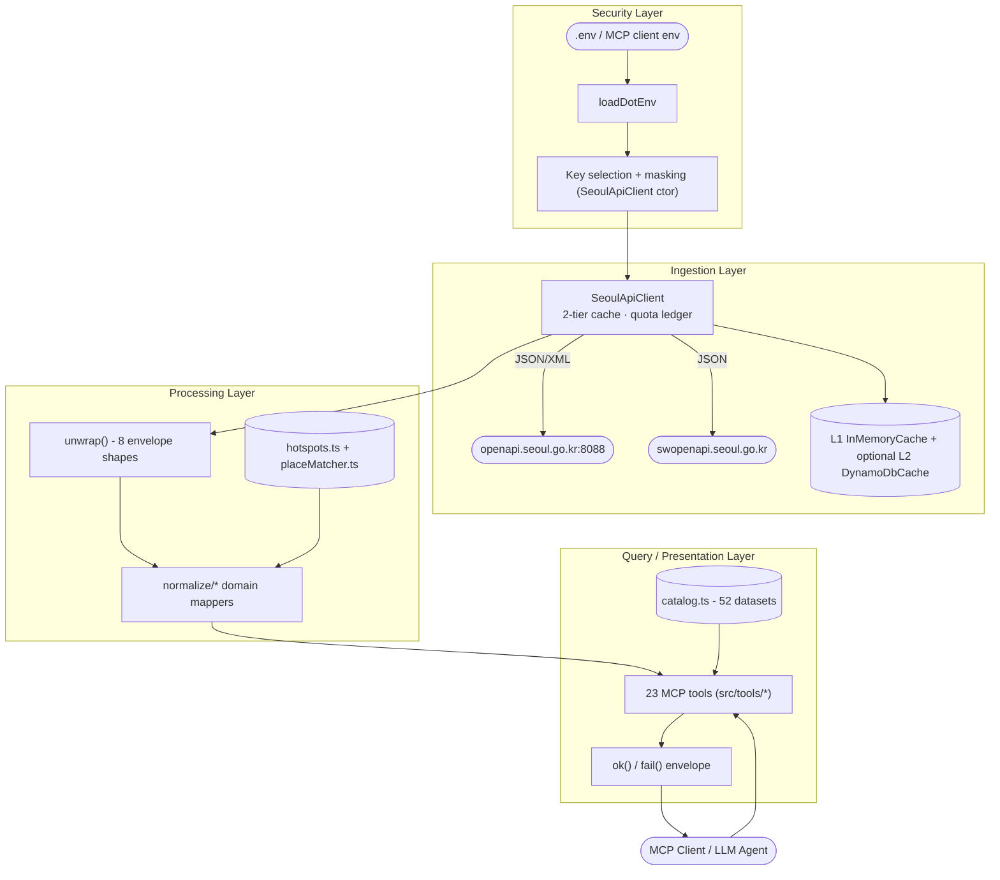
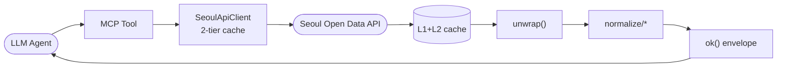

# Architecture

---

# English

## System Overview

`seoul-opendata-mcp` is an [MCP](https://modelcontextprotocol.io) server served over stdio (and over Streamable HTTP on `:8000` via `src/http.ts` for Amazon Bedrock AgentCore Runtime) (TypeScript, strict mode, ESM, Node >= 18) that exposes Seoul Open Data Plaza's real-time city APIs as 23 MCP tools for LLM agents.

It wraps two upstream HTTP APIs — the general Seoul Open Data Plaza (`openapi.seoul.go.kr:8088`) and the dedicated subway realtime endpoint (`swopenapi.seoul.go.kr`) — behind a single HTTP client, `SeoulApiClient`, that adds key fallback, TTL caching, pagination, one retry on transient failure, and an XML-fallback JSON parser (the upstream sometimes returns an XML error body even for a JSON request). Raw upstream payloads arrive in eight distinct envelope shapes; a normalization layer (`src/normalize`) unwraps and maps each into a stable domain shape before 19 MCP tools (`src/tools`) present it to the calling agent inside one uniform `{data, asOf, source, notes}` envelope. Two API keys (`SEOUL_API_KEY`, `SEOUL_SUBWAY_API_KEY`) are loaded from the process environment or a local `.env` file, are masked before they can ever appear in logs or error messages, and fall back to a scope-limited built-in sample key when unset, so the server is usable out of the box with zero configuration.

## Components

### Ingestion Layer

- **`src/client/seoulApi.ts`** (`SeoulApiClient`) -- Single HTTP entry point for both upstream bases (`OPEN_BASE = openapi.seoul.go.kr:8088`, `SUBWAY_BASE = swopenapi.seoul.go.kr/api/subway`). `buildUrl()` composes the positional path segments the Seoul API expects (`key/type/service/start/end/...params`); `request()` retries once after `retryDelayMs` (default 300 ms) on an HTTP 5xx or network failure, cancelling the discarded body, and does not retry a timeout (fails fast with `TIMEOUT`, so worst-case latency is one `timeoutMs`); `fetchAll()` auto-paginates a standard-envelope service up to `totalCount` or a caller-supplied `max`.
- **`src/client/cache.ts`** (`CacheBackend`, `InMemoryCache`, `CompositeCache`) -- Two-tier cache abstraction: `InMemoryCache` is the always-on L1 (per-process `Map`), and `CompositeCache` layers an optional L2 (`CacheBackend`) underneath it, keyed by the full request URL. Each entry carries a source-aligned soft TTL (the `SOFT_TTL` map in `seoulApi.ts`, e.g. 300s for `citydata`, 15s for subway arrivals) under a single hard TTL ceiling (`HARD_TTL_MS`, 24h) past which an entry is discarded outright. A soft-expired ("stale") entry is still returned immediately with a `캐시된 데이터(약 N분 경과) — 백그라운드 갱신 중` note while exactly one background refresh fires per URL (`SeoulApiClient`'s in-process single-flight `inflight` map collapses concurrent identical requests into one upstream call); an L2 read/write failure is caught and logged, falling back to L1 without failing the request.
- **`src/client/quota.ts`, `src/client/dynamo.ts`** (`QuotaLedger`, `InMemoryLedger`, `DynamoDbLedger`, `DynamoDbCache`, `maybeAttachL2`) -- A daily-quota ledger tracks per-key (general/subway isolated via `keyIdOf`, a sha256-derived id that never stores the raw key) call counts against a KST calendar day (`kstDayKey`); at ≥80% of `QUOTA_DAILY_LIMIT` (default 1000, guarded by `parseQuotaLimit`) responses carry a usage-warning note, and at 100% the client serves cache-only (stale if available, otherwise an empty result with an explanatory note) instead of erroring. `maybeAttachL2` lazily imports `@aws-sdk/client-dynamodb`/`lib-dynamodb` and wires a `DynamoDbCache` (L2) + `DynamoDbLedger` (shared quota) into the client only when `CACHE_TABLE_NAME` is set, so stdio/local users never pay the import cost or the AWS SDK dependency at runtime.
- **`src/client/env.ts`** (`loadDotEnv`) -- Minimal `.env` parser that only fills environment variables not already set on `process.env`, so an explicitly injected env (for example from an MCPB `user_config`) always wins over a checked-in `.env`.

### Processing Layer

- **`src/client/response.ts`** (`unwrap`) -- Normalizes 8 distinct upstream envelope shapes -- a bare `RESULT`-only error, the swopenapi `errorMessage` wrapper, swopenapi's bare `{status, code, message}` error form, `citydata_ppltn`'s `SeoulRtd.citydata_ppltn` wrapper, `citydata_cmrcl`'s `LIVE_CMRCL_STTS` wrapper, the XML-parsed `citydata`'s `SeoulRtd.citydata` wrapper, `bikeList`'s `rentBikeStatus` wrapper, and the standard `{[service]: {list_total_count, RESULT, row}}` shape -- into one `{rows, totalCount, note}` shape, throwing `SeoulApiError` on any non-`INFO-000` result code.
- **`src/normalize/*.ts`** (`population`, `commercial`, `subway`, `bike`, `parking`, `culture`, `air`, `health`, `stats`, `citydata`) -- One mapper module per domain that turns the unwrapped raw rows into the typed shape each tool returns (`Population`, `Commercial`, `SubwayArrival`, `BikeStation`, `ParkingLot`, `CulturalEvent`, `AirQuality`, `Pharmacy`, `SubwayRidership` / `LivingPopulation` / `RealEstateDeal`).
- **`src/data/hotspots.ts`, `src/data/placeMatcher.ts`** -- The 121-hotspot lookup table and the alias/bigram fuzzy matcher (`searchPlace`) that resolves a free-form place name before any `citydata`-family tool call.

### Query / Presentation Layer

- **`src/index.ts`** (`buildServer`) -- Wires an `McpServer` with the 9 `register*Tools()` functions and exposes all 23 tools listed in `TOOL_NAMES`.
- **`src/tools/{common,population,traffic,culture,environment,stats,realestate,health,meta}.ts`** -- The 23 MCP tools grouped by domain: place/snapshot/alerts, population/commercial, subway arrivals and timetables/bike/parking/road, cultural events and public service reservations, air/weather, daily and hourly subway ridership/living population, real-estate sale and rent transactions plus assessed land price, pharmacies, and the generic dataset-catalog trio.
- **`src/tools/envelope.ts`** (`ok`/`fail`) -- The single response shape every tool returns, `{data, asOf, source, notes[]}`, with a sample-mode note appended automatically whenever `ctx.client.isSample` is true.
- **`src/tools/resolve.ts`** (`resolvePlace`) -- Shared place-resolution helper used by every `citydata`-family tool; returns an early "candidates" response instead of an error when a place name is ambiguous or unmatched.
- **`src/data/catalog.ts`** (`CATALOG`, `searchCatalog`, `validateCall`) -- The 29-dataset hybrid catalog behind `search_dataset`/`get_dataset_spec`/`call_dataset`: 15 datasets with a dedicated tool (14 of which are also callable via `call_dataset`, plus 1 non-callable entry, `LIVE_DST_MESSAGE`, surfaced only through `get_disaster_alerts`), and 14 catalog-only datasets.

### Security Layer

- **`SEOUL_API_KEY` / `SEOUL_SUBWAY_API_KEY`** -- Two keys read from `process.env` (or a local `.env` via `loadDotEnv`). `SeoulApiClient`'s constructor falls the subway key back to the general key when `SEOUL_SUBWAY_API_KEY` is unset.
- **Key masking** -- `maskedKey()` / `maskedSubwayKey()` only ever expose the first 4 characters (or the literal `sample`); every error message that embeds the key (HTTP or network failures) uses the masked form, never the raw key.
- **Sample-mode fallback** -- When no key is set, `SeoulApiClient.isSample` is `true` and the internal key becomes the literal `sample`: `citydata`-family requests are clamped to the single `광화문·덕수궁` hotspot, and every request made with the active `sample` key -- subway included -- is clamped to at most 5 rows (`fetchUnwrapped` clamps `end` to `start + 4`), and every affected tool response carries a `SAMPLE_NOTE` (with the key-signup URL) via the shared `ok()` envelope.
- **`manifest.json` `user_config`** -- Declares both keys as `sensitive: true`, optional inputs for the MCPB one-click installer, so neither key is ever embedded in the bundled package.

## Full Architecture Diagram

## Data Flow Summary

## Key Design Decisions

- **Fixtures are truth** -- Capture real upstream responses once (`scripts/capture-fixtures.ts`) into `tests/fixtures/*.json|xml` and treat them as immutable inputs rather than hand-written mocks, so every `normalize/*` mapper is verified against an actual upstream shape instead of an assumption about it. Recorded as [ADR-001](decisions/ADR-001-fixtures-as-source-of-truth.md).
- **Single-key default, dual-key override** -- Require only `SEOUL_API_KEY` for every tool, and treat `SEOUL_SUBWAY_API_KEY` as an optional override that falls back to the general key when unset, so most users request exactly one credential while the subway-specific quota can still be isolated when needed.
- **Congestion is a relative indicator, not a raw count** -- Expose card-payment-based commercial activity and population as categorical levels (`한산한`→`분주한`, `여유`→`붐빔`) with an explicit "not a full census" note in the tool response, because the underlying feed is a payment/telecom sample, not an exhaustive count, and presenting it as an absolute figure would overstate its precision.
- **Catalog hybrid over one-tool-per-dataset** -- Promote 14 high-traffic datasets to a dedicated, fully-typed, normalized tool (plus 1 tool-only, non-`call_dataset`-callable entry for disaster alerts), and expose the remaining 14 datasets through a 3-tool generic trio (`search_dataset` / `get_dataset_spec` / `call_dataset`), avoiding the "thousands of tools" anti-pattern where every raw dataset would need its own MCP tool and schema. Recorded as [ADR-002](decisions/ADR-002-hybrid-tool-exposure.md).
- **One HTTP code path for every service** -- Route every upstream call (JSON, XML, subway) through the same `fetchUnwrapped()` → cache → `unwrap()` pipeline in `SeoulApiClient`, so caching, retry, sample-mode clamping, and envelope normalization are implemented and tested exactly once instead of per-tool. Recorded as [ADR-003](decisions/ADR-003-single-http-path-and-env-keys.md).
- **Decouple session count from upstream quota** -- Under AgentCore Runtime, each concurrent session is its own process with a cold L1 cache, so session count and upstream call volume would otherwise scale together against the same shared daily quota. An optional, env-gated (`CACHE_TABLE_NAME`) L2 (DynamoDB) tier shared across sessions, plus stale-while-revalidate and a daily quota ledger that degrades to stale-only instead of erroring, breaks that coupling while leaving the zero-config stdio path (no `CACHE_TABLE_NAME`) byte-for-byte unchanged. Recorded as [ADR-004](decisions/ADR-004-session-scaling-two-tier-cache.md).

## Operations

- [`docs/runbooks/agentcore-deploy.md`](runbooks/agentcore-deploy.md) -- deploy (ECR push -> `create-agent-runtime`), verify (`/ping`, `tools/list`), rollback (pin an endpoint to the previous version), and incident response (L2 cache errors falling back to L1, quota-exhaustion stale-only mode) for the AgentCore Runtime container (`src/http.ts` / `Dockerfile`).

The next most likely runbooks, still unwritten -- see [`docs/runbooks/.template.md`](runbooks/.template.md) for the format to use when adding one:

- A **key rotation / sample-mode diagnosis** runbook (Security Layer) -- what to check when a tool response unexpectedly carries the sample-mode note or an `INFO-100`/key-related `SeoulApiError`.
- An **MCPB bundle-and-release** runbook -- the `npm run build` -> `npm run bundle` -> `npm run prepublishOnly` sequence used to produce `seoul-opendata-mcp.mcpb` and the npm package.

Related architectural decisions are recorded under `docs/decisions/` -- see [ADR-001](decisions/ADR-001-fixtures-as-source-of-truth.md), [ADR-002](decisions/ADR-002-hybrid-tool-exposure.md), [ADR-003](decisions/ADR-003-single-http-path-and-env-keys.md), and [ADR-004](decisions/ADR-004-session-scaling-two-tier-cache.md); use [`docs/decisions/.template.md`](decisions/.template.md) to add a new one.

---

# 한국어

## 시스템 개요

`seoul-opendata-mcp`는 서울 열린데이터광장의 실시간 도시데이터 API를 LLM 에이전트를 위한 23개 MCP tool로 노출하는 [MCP](https://modelcontextprotocol.io) 서버입니다. stdio로 동작하고, Amazon Bedrock AgentCore Runtime용으로 `src/http.ts`가 `:8000`에서 Streamable HTTP도 제공합니다 (TypeScript strict 모드, ESM, Node >= 18).

이 서버는 서울 열린데이터광장 일반 API(`openapi.seoul.go.kr:8088`)와 지하철 실시간 도착 전용 API(`swopenapi.seoul.go.kr`), 두 개의 업스트림 HTTP API를 `SeoulApiClient`라는 단일 HTTP 클라이언트로 감쌉니다. 이 클라이언트는 키 폴백, TTL 캐시, 페이지네이션, 일시적 오류 시 1회 재시도, 그리고 XML 폴백 JSON 파서(업스트림이 JSON 요청에도 XML 형태의 에러 본문을 돌려주는 경우가 있음)를 제공합니다. 업스트림 원본 응답은 8가지 서로 다른 봉투(envelope) 형태로 도착하는데, 정규화 계층(`src/normalize`)이 이를 언랩하여 안정적인 도메인 형태로 매핑한 뒤, 19개 MCP tool(`src/tools`)이 이를 호출 에이전트에게 `{data, asOf, source, notes}`라는 하나의 통일된 봉투로 전달합니다. 두 종류의 API 키(`SEOUL_API_KEY`, `SEOUL_SUBWAY_API_KEY`)는 프로세스 환경변수 또는 로컬 `.env` 파일에서 로드되며, 로그나 에러 메시지에 노출되기 전에 항상 마스킹되고, 미설정 시에는 범위가 제한된 내장 샘플 키로 폴백되므로 별도 설정 없이도 서버를 바로 사용할 수 있습니다.

## 구성요소

### Ingestion Layer (수집 계층)

- **`src/client/seoulApi.ts`** (`SeoulApiClient`) -- 두 업스트림 베이스(`OPEN_BASE = openapi.seoul.go.kr:8088`, `SUBWAY_BASE = swopenapi.seoul.go.kr/api/subway`)에 대한 단일 HTTP 진입점입니다. `buildUrl()`은 서울 API가 요구하는 위치 기반 경로 세그먼트(`key/type/service/start/end/...params`)를 구성하고, `request()`는 HTTP 5xx 또는 네트워크 오류 시 `retryDelayMs`(기본 300ms) 뒤 1회 재시도하고 버리는 응답 본문을 정리하며, 타임아웃은 재시도하지 않고 `TIMEOUT`으로 바로 실패시켜 최악 지연을 `timeoutMs` 1회로 묶고, `fetchAll()`은 표준 봉투 서비스를 `totalCount` 또는 호출자가 지정한 `max`까지 자동으로 페이지 순회합니다.
- **`src/client/cache.ts`** (`CacheBackend`, `InMemoryCache`, `CompositeCache`) -- 2단 캐시 추상화입니다. `InMemoryCache`는 항상 켜져 있는 L1(프로세스별 `Map`)이고, `CompositeCache`가 선택적 L2(`CacheBackend`)를 그 아래에 겹겹이 쌓으며, 전체 요청 URL을 키로 사용합니다. 각 엔트리는 원천 갱신 주기에 맞춘 soft TTL(`seoulApi.ts`의 `SOFT_TTL` 맵, 예: `citydata` 300초, 지하철 도착 15초)을 하나의 hard TTL 상한(`HARD_TTL_MS`, 24시간) 아래에 가지며, 이 상한을 넘으면 엔트리를 완전히 폐기합니다. soft TTL이 지난("stale") 엔트리는 `캐시된 데이터(약 N분 경과) — 백그라운드 갱신 중` 안내와 함께 즉시 반환되며, URL당 정확히 한 번의 백그라운드 갱신만 발화합니다(`SeoulApiClient`의 프로세스 내 single-flight `inflight` 맵이 동일 요청 동시 호출을 하나의 업스트림 호출로 병합). L2 읽기/쓰기 실패는 잡아서 로그만 남기고 L1으로 폴백하며 요청 자체를 실패시키지 않습니다.
- **`src/client/quota.ts`, `src/client/dynamo.ts`** (`QuotaLedger`, `InMemoryLedger`, `DynamoDbLedger`, `DynamoDbCache`, `maybeAttachL2`) -- 일일 쿼터 원장이 키별(일반/지하철을 `keyIdOf`로 분리 — 원본 키를 저장하지 않는 sha256 기반 식별자) 호출 수를 KST 기준 하루(`kstDayKey`)에 대해 추적합니다. `QUOTA_DAILY_LIMIT`(기본 1000, `parseQuotaLimit`로 값 검증)의 80% 이상이면 응답에 사용량 경고 note가 붙고, 100%에 도달하면 에러 대신 캐시만으로 응답합니다(가능하면 stale, 없으면 안내 note가 담긴 빈 결과). `maybeAttachL2`는 `CACHE_TABLE_NAME`이 설정된 경우에만 `@aws-sdk/client-dynamodb`/`lib-dynamodb`를 lazy import하여 `DynamoDbCache`(L2)와 `DynamoDbLedger`(공유 쿼터)를 클라이언트에 연결하므로, stdio/로컬 사용자는 이 import 비용이나 AWS SDK 의존을 런타임에 전혀 지불하지 않습니다.
- **`src/client/env.ts`** (`loadDotEnv`) -- `process.env`에 아직 설정되지 않은 환경변수만 채우는 최소한의 `.env` 파서입니다. 이 때문에 (예: MCPB `user_config`에서) 명시적으로 주입된 환경변수가 항상 커밋된 `.env`보다 우선합니다.

### Processing Layer (처리 계층)

- **`src/client/response.ts`** (`unwrap`) -- 업스트림의 8가지 서로 다른 봉투 형태 -- `RESULT`만 있는 에러 응답, swopenapi의 `errorMessage` 래퍼, swopenapi의 `{status, code, message}` 형태 에러, `citydata_ppltn`의 `SeoulRtd.citydata_ppltn` 래퍼, `citydata_cmrcl`의 `LIVE_CMRCL_STTS` 래퍼, XML로 파싱된 `citydata`의 `SeoulRtd.citydata` 래퍼, `bikeList`의 `rentBikeStatus` 래퍼, 그리고 표준 `{[service]: {list_total_count, RESULT, row}}` 형태 -- 를 하나의 `{rows, totalCount, note}` 형태로 정규화하며, `INFO-000`이 아닌 모든 결과 코드에 대해 `SeoulApiError`를 던집니다.
- **`src/normalize/*.ts`** (`population`, `commercial`, `subway`, `bike`, `parking`, `culture`, `air`, `health`, `stats`, `citydata`) -- 언랩된 원본 행(row)을 각 tool이 반환하는 타입이 지정된 형태(`Population`, `Commercial`, `SubwayArrival`, `BikeStation`, `ParkingLot`, `CulturalEvent`, `AirQuality`, `Pharmacy`, `SubwayRidership` / `LivingPopulation` / `RealEstateDeal`)로 변환하는 도메인별 매퍼 모듈입니다.
- **`src/data/hotspots.ts`, `src/data/placeMatcher.ts`** -- 121개 핫스팟 조회 테이블과, `citydata` 계열 tool 호출 전에 자유 형식 장소명을 확정하는 별칭/2-gram 유사도 매처(`searchPlace`)입니다.

### Query / Presentation Layer (조회·표현 계층)

- **`src/index.ts`** (`buildServer`) -- `McpServer`를 9개의 `register*Tools()` 함수와 연결하고, `TOOL_NAMES`에 나열된 23개 tool 전체를 노출합니다.
- **`src/tools/{common,population,traffic,culture,environment,stats,realestate,health,meta}.ts`** -- 도메인별로 그룹화된 23개 MCP tool입니다: 장소/스냅샷/재난문자, 인구/상권, 지하철 도착과 시간표/따릉이/주차/도로, 문화행사와 공공서비스예약, 대기질/날씨, 지하철 일별·시간대별 승하차/생활인구, 부동산 매매와 전월세 실거래가 및 개별공시지가, 약국, 그리고 범용 데이터셋 카탈로그 3종입니다.
- **`src/tools/envelope.ts`** (`ok`/`fail`) -- 모든 tool이 반환하는 단일 응답 형태 `{data, asOf, source, notes[]}`이며, `ctx.client.isSample`이 `true`일 때 샘플 모드 안내를 자동으로 추가합니다.
- **`src/tools/resolve.ts`** (`resolvePlace`) -- 모든 `citydata` 계열 tool이 공유하는 장소 확정 헬퍼로, 장소명이 모호하거나 매칭되지 않을 때 에러 대신 "candidates" 응답을 조기 반환합니다.
- **`src/data/catalog.ts`** (`CATALOG`, `searchCatalog`, `validateCall`) -- `search_dataset`/`get_dataset_spec`/`call_dataset` 뒤에 있는 52개 데이터셋 하이브리드 카탈로그입니다: 정식 tool을 보유한 15종(이 중 14종은 `call_dataset`으로도 호출 가능, 나머지 1종인 `LIVE_DST_MESSAGE`는 `get_disaster_alerts`를 통해서만 노출되는 직접 호출 불가 항목), 그리고 카탈로그 전용 14종으로 구성됩니다.

### Security Layer (보안 계층)

- **`SEOUL_API_KEY` / `SEOUL_SUBWAY_API_KEY`** -- `process.env`(또는 `loadDotEnv`를 통한 로컬 `.env`)에서 읽는 두 종류의 키입니다. `SeoulApiClient` 생성자는 `SEOUL_SUBWAY_API_KEY`가 미설정이면 지하철 키를 일반 키로 폴백시킵니다.
- **키 마스킹** -- `maskedKey()` / `maskedSubwayKey()`는 항상 앞 4글자(또는 리터럴 `sample`)만 노출합니다. 키를 포함하는 모든 에러 메시지(HTTP/네트워크 오류)는 원본 키가 아닌 마스킹된 형태만 사용합니다.
- **샘플 모드 폴백** -- 키가 설정되지 않으면 `SeoulApiClient.isSample`이 `true`가 되고 내부 키는 리터럴 `sample`이 됩니다: `citydata` 계열 요청은 `광화문·덕수궁` 단일 핫스팟으로만 제한되고, 샘플 키가 활성인 모든 요청은 지하철을 포함해 5행으로 클램프됩니다(`fetchUnwrapped`가 `end`를 `start + 4`로 클램프). 영향을 받는 모든 tool 응답에는 공용 `ok()` 봉투를 통해 `SAMPLE_NOTE`(키 발급 URL 포함)가 붙습니다.
- **`manifest.json` `user_config`** -- 두 키를 모두 `sensitive: true`인 선택적(optional) 입력으로 선언하여, MCPB 원클릭 설치 패키지에 키가 내장되지 않도록 합니다.

## 전체 아키텍처 다이어그램

## 데이터 흐름 요약

## 주요 설계 결정

- **픽스처가 진실이다** -- 실제 업스트림 응답을 한 번 캡처(`scripts/capture-fixtures.ts`)하여 `tests/fixtures/*.json|xml`을 불변 입력으로 취급하고, 손으로 작성한 목(mock)을 쓰지 않습니다. 이를 통해 모든 `normalize/*` 매퍼가 업스트림 형태에 대한 가정이 아니라 실제 형태로 검증됩니다. [ADR-001](decisions/ADR-001-fixtures-as-source-of-truth.md)로 기록되어 있습니다.
- **단일 키 기본, 이중 키는 선택적 오버라이드** -- 모든 tool은 기본적으로 `SEOUL_API_KEY` 하나만 요구하고, `SEOUL_SUBWAY_API_KEY`는 미설정 시 일반 키로 폴백되는 선택적 오버라이드로 취급합니다. 대부분의 사용자는 키 하나만 발급받으면 되고, 필요할 때만 지하철 전용 쿼터를 분리할 수 있습니다.
- **혼잡도는 절대값이 아니라 상대 지표다** -- 카드 결제 기반 상권 현황과 인구를 절대 수치가 아니라 범주형 수준(`한산한`→`분주한`, `여유`→`붐빔`)으로 노출하고, tool 응답에 "전수 데이터가 아니다"라는 안내를 명시적으로 포함합니다. 근본 데이터가 결제/통신 표본이며 전수 집계가 아니므로, 절대값으로 제시하면 실제보다 정밀한 것처럼 오해를 줄 수 있기 때문입니다.
- **데이터셋마다 tool을 만들지 않는 카탈로그 하이브리드** -- 트래픽이 많은 14개 데이터셋은 전용 타입 정규화 tool로 승격시키고(재난문자는 `call_dataset`으로 호출할 수 없는 tool 전용 1건 추가), 나머지 14개 데이터셋은 3개의 범용 tool(`search_dataset` / `get_dataset_spec` / `call_dataset`)로 노출합니다. 모든 원본 데이터셋마다 별도의 MCP tool과 스키마가 필요해지는 "수천 개 tool" 안티패턴을 피하기 위한 결정입니다. [ADR-002](decisions/ADR-002-hybrid-tool-exposure.md)로 기록되어 있습니다.
- **모든 서비스가 거치는 단 하나의 HTTP 경로** -- JSON, XML, 지하철 호출 전부를 `SeoulApiClient` 내 동일한 `fetchUnwrapped()` → 캐시 → `unwrap()` 파이프라인으로 라우팅합니다. 이를 통해 캐싱, 재시도, 샘플 모드 클램핑, 봉투 정규화를 tool마다 반복 구현·검증하지 않고 한 곳에서만 구현·검증합니다. [ADR-003](decisions/ADR-003-single-http-path-and-env-keys.md)로 기록되어 있습니다.
- **세션 수와 업스트림 쿼터의 분리** -- AgentCore Runtime 환경에서는 동시 세션마다 별도 프로세스와 콜드 L1 캐시를 가지므로, 그대로 두면 세션 수와 업스트림 호출량이 동일한 공용 일일 쿼터를 두고 함께 증가합니다. 선택적이며 env로 게이트된(`CACHE_TABLE_NAME`) 세션 간 공유 L2(DynamoDB) 계층에, stale-while-revalidate와 에러 대신 stale-only로 저하되는 일일 쿼터 원장을 더해 이 결합을 끊으면서도, `CACHE_TABLE_NAME`을 설정하지 않는 무설정 stdio 경로는 바이트 단위로 그대로 유지됩니다. [ADR-004](decisions/ADR-004-session-scaling-two-tier-cache.md)로 기록되어 있습니다.

## 운영

- [`docs/runbooks/agentcore-deploy.md`](runbooks/agentcore-deploy.md) -- AgentCore Runtime 컨테이너(`src/http.ts` / `Dockerfile`)의 배포(ECR push → `create-agent-runtime`), 검증(`/ping`, `tools/list`), 롤백(이전 버전으로 엔드포인트 핀), 장애 대응(L2 캐시 오류의 L1 폴백, 쿼터 소진 stale-only 모드)을 다룹니다.

아직 작성되지 않은, 다음으로 필요해질 가능성이 높은 런북들 -- 추가할 때 사용할 형식은 [`docs/runbooks/.template.md`](runbooks/.template.md)를 참고하세요.

- **키 회전 / 샘플 모드 진단** 런북(보안 계층) -- tool 응답에 예기치 않게 샘플 모드 안내나 `INFO-100` 등 키 관련 `SeoulApiError`가 나타날 때 확인할 사항.
- **MCPB 번들·릴리스** 런북 -- `seoul-opendata-mcp.mcpb`와 npm 패키지를 만드는 `npm run build` → `npm run bundle` → `npm run prepublishOnly` 절차.

관련 아키텍처 결정은 `docs/decisions/` 아래에 기록되어 있습니다 -- [ADR-001](decisions/ADR-001-fixtures-as-source-of-truth.md), [ADR-002](decisions/ADR-002-hybrid-tool-exposure.md), [ADR-003](decisions/ADR-003-single-http-path-and-env-keys.md), [ADR-004](decisions/ADR-004-session-scaling-two-tier-cache.md)를 참고하세요. 새 결정을 추가할 때는 [`docs/decisions/.template.md`](decisions/.template.md)를 사용합니다.
